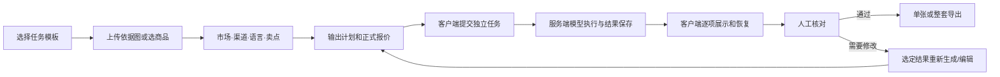

# WEAVIA 商品视觉创作 PRD v2（竞品效果对标评审稿）

版本：v2.0 · 2026-10-23  
状态：待产品确认；本文是需求与验收方案，不代表功能已完成，也不授权上线或付费模型调用。  
适用范围：WEAVIA macOS 桌面客户端、Go 服务端、运营后台。  
承接文档：[现有产品 PRD v1](./WEAVIA_PRD_v1.md)、[当前试运行说明](../CREATIVE_TRIAL.md)、[服务端创作接口](../../../server/docs/CREATIVE_TASKS.md)。
本稿聚焦商品图片与视频对标；与旧文档的 DAG 执行位置或阶段描述冲突时，以用户已确认的“DAG 始终由客户端执行”和本稿阶段定义为准。

## 1. 本次要交付的结果

让主要在中国工作的电商运营人员，用一款商品的真实素材，在同一工作台完成：

> 选择创作任务 → 上传商品依据图或选择商品 → 确定渠道、市场、语言与卖点 → 看到明确的输出计划和总费用 → 生成图片套图或商品短视频 → 逐项核对、修改、下载交付。

产品覆盖中国和海外电商平台。渠道、市场与语言是创作参数，不能把产品写死为 TikTok 工具。面向新手时，先让用户选择“要做什么”，再由系统推荐模型；模型和高级参数可展开修改。

### 1.1 “达到竞品效果”的验收定义

1. **任务入口相近**：能从首页直接进入商品套图、精修、广告素材、详情页等明确任务，且每个入口有专属输入与结果说明。
2. **商品套图是真正的套图**：3/5/7 张有不同用途与顺序的图片，每张独立生成、预览、重试、核对和下载；同一提示词生成若干近似变体不算套图。
3. **视频是真实结果**：用户提供商品图或明确选择纯文字模式后，得到可播放、可下载、可在重启后找回的视频；分镜脚本本身不算视频完成。
4. **运营能交付**：可核对商品外观、包装、Logo、画面文字、事实与市场语言，保留源素材、版本和任务费用，导出所选图片或整套文件。
5. **可安全试运行**：账号数据隔离、可用模型与报价可信、付费调用幂等、失败可恢复、服务端 Key 不进前端包。

对标的是可见的任务覆盖和使用结果，不复制竞品的品牌素材、文案或具体视觉。竞品未登录区域的内部实现、生成质量、实际扣费与成功率尚未验证，不能作为已确认事实。

## 2. 参考产品与当前差距

2026-10-23 查看了 [竞品首页](https://vi.91jiguang.com/)、[AI 图片工作台](https://vi.91jiguang.com/image-studio)、[商品套图页面](https://vi.91jiguang.com/image-studio/product-set)和[视频入口](https://vi.91jiguang.com/video-studio)。公开页面可见商品套图、A+ 详情页、爆款图参考、六宫格、商品精修、多角度、广告素材、社交配图、批量套图等入口。商品套图页面显示 1～6 张参考图、市场/语言、3/5/7 张及按用途区分的效果示例。视频入口显示图片/视频参考与一句话创意。以下对竞品能力的描述仅限这些公开页面。

| 可见体验 | WEAVIA 当前 | 本 PRD 目标 |
| --- | --- | --- |
| 首页快速开始与灵感 | 有通用创作框和示例；关键提交入口在较下方 | 首屏看到任务卡、素材入口、最近项目与明确下一步 |
| 商品套图 | 可一次提交 1/2/4 张，结果分开保存；没有用途计划 | 3/5/7 张异质套图，逐张任务与成套交付 |
| 商品精修 / 改图 | 已有图像编辑与版本基础 | 与商品依据图、核对状态和重新生成串成闭环 |
| 广告图 / 详情页 / 六宫格等 | 通用提示词可尝试，但没有完整任务形态 | 分任务提供输入、输出结构、预览与导出 |
| 商品视频 | 有分镜策划、文字生成视频适配器；视频模型当前关闭 | 首先交付单镜头可播放视频，再交付客户端多镜头成片 |
| 作品与历史 | 任务历史在服务端；商品、作品核对主要在本机 | 按用户/工作区同步，断网与重启后恢复 |
| 费用 | 客户端估算；现有正式报价只覆盖单张固定尺寸图片 | 每个输出的服务端报价、总价和最终结算可追溯 |

现阶段不得对外写“已支持商品套图”“已支持商品图生成视频”或“视频工作流已完成”，直到对应验收项通过真实模型任务。

## 3. 目标用户、场景与产品原则

### 3.1 首要用户

- **中国电商运营**：需要淘宝、天猫、京东、拼多多、抖音等商品主图、详情页、活动图。
- **跨境电商运营**：需要 TikTok Shop、Amazon、Shopee、Lazada、独立站等市场与语言版本。
- **代运营与设计协作者**：同时处理多个品牌和 SKU，需要隔离、复用模板、核对和打包交付。

首批按新手运营人员设计。专业用户可展开模型、种子、参考强度等设置，但无需先理解模型名称或 DAG 节点。

### 3.2 原则

- **先任务、后模型**：入口以“商品套图”“广告图”“商品视频”命名。
- **商品真实性优先**：生成输出要提示人工核对；系统不声称自动验证功效、认证或图片文字准确性。
- **少填但不丢信息**：允许不建商品直接上传；有商品时带入已核实事实与禁止声明。
- **费用先于提交**：缺报价、余额不足、模型不可用时阻止付费提交。
- **结果比过程重要**：生成后直接回到原创作会话或项目的结果区，任务中心负责跨项目追踪与异常处理。
- **DAG 始终在客户端**：客户端编排套图、批量与多镜头流程；服务端只执行独立模型任务、保存任务和结果、管理费用。关闭客户端后，已受理的单项任务可在服务端完成；未提交的后续节点在重启后由客户端恢复。

## 4. 信息架构与主流程

建议主导航：**首页创作 / 创作工具 / 商品 / 素材 / 作品 / 任务**；工作流编辑器收在“高级工具”，账户、Credits 与设置固定在侧栏底部。创作工具按业务任务分组，模型目录不作为新手的一级导航。

### 4.1 首次使用

首页首屏给出“商品套图”“商品宣传图”“商品短视频”三个主要按钮和一个上传区。用户选择任务后进入相应工作台；不要求先创建工作区、项目或商品。第一次点击生成前，界面才要求登录并保留草稿。首次登录后可继续原操作。

### 4.2 已有商品

从商品卡选择任务时带入名称、SKU、依据图、事实与限制。用户仍能添加本次参考图并调整渠道/语言。商品编辑不回写历史任务快照。

### 4.3 空、加载和失败状态

无模型显示“当前任务尚无可用模型”及配置/联系客服动作，不出现可点击的付费按钮。上传中显示每个文件进度和重试；余额不足显示差额；任务部分成功显示成功项与失败项，允许只重试失败项；网络断开保留草稿并查询已提交任务，不能自动重复扣费。

## 5. 功能范围与优先级

优先级表示交付顺序；“对标达成”须覆盖本表全部标记为对标必需的项目。

| ID | 任务 | 输出定义 | 阶段 |
| --- | --- | --- | --- |
| IMG-01 | 商品套图 | 3/5/7 张，至少包含主图、场景、卖点；5 张加细节和使用场景，7 张按类目补充角度/包装/规格 | M1，必需 |
| IMG-02 | 商品精修 | 去瑕疵、背景整理、光影与清晰度调整，保留原图及新版本 | M1，必需 |
| IMG-03 | 广告宣传图 | 渠道、受众、活动文案、尺寸变体；可人工修改文案 | M1，必需 |
| IMG-04 | A+ / 详情页 | 模块顺序、卖点文案、图片；可逐模块重做和导出 | M3，必需 |
| IMG-05 | 参考爆款图 | 用户提供有权使用的参考版式，指定保留/替换元素；生成自己的商品内容 | M3，必需 |
| IMG-06 | 商品六宫格 | 六个角度汇入一张图，角度标签与商品外观可核对 | M3，必需 |
| IMG-07 | 多角度商品图 | 每个角度单独成图，明确正面、侧面、背面或细节 | M3，必需 |
| IMG-08 | 社交配图 | 平台规格、主题、风格及可编辑文案 | M3，必需 |
| IMG-09 | 批量套图 | 多 SKU 映射、批次费用、逐 SKU 进度、部分失败重试 | M3，必需 |
| VID-01 | 商品单镜头短片 | 商品图驱动优先；生成封面、可播放视频、下载文件 | M2，必需 |
| VID-02 | 分镜及多镜头成片 | 生成/手写分镜，逐镜头预览、替换、客户端合成 | M3，必需 |
| CORE-01 | 灵感与任务模板 | 示例卡带入模板，但要求替换为自己的商品素材 | M1，必需 |
| CORE-02 | 作品核对与成套导出 | 逐项状态、备注、版本、ZIP 与清单 | M1，必需 |

首个试运行版本优先交付 M0 + M1；用户确认“达到竞品效果”以 M0～M3 全部必需项通过验收为准。

## 6. 核心任务详细规则

### 6.1 商品套图（IMG-01）

**输入**：同一商品 1～6 张 JPG/PNG/WebP 依据图；可选关联商品/SKU；品类、渠道、国家/市场、输出语言、卖点、禁止声明、目标比例。文件上限由服务端能力目录返回，客户端在选择文件前显示；不在产品文案里写死竞品的 20 MB 限值。

**输出计划**：用户选 3/5/7 张后，先看到每张卡片的用途、建议文案与规格；能删除、调整顺序和编辑单张要求。不同品类的计划可不同，但默认至少提供主图、场景、卖点。用户确认后服务端返回逐张报价与总价。

**执行**：客户端按输出计划生成独立任务，默认限制并发。每张保留自己的输入、模型、参数、费用与结果。任何一张失败都不清除成功项；重试只创建失败项的新任务并显示新增费用。套图可保存为项目成果。

**结果**：卡片按计划顺序排列；单张放大、前后对比、核对、重新生成、下载；整套 ZIP 包含图片、用途命名和 manifest。所谓“风格一致”用同一套品牌/场景参数与参考图约束实现，并由人工核对，不承诺模型天然保证一致。

### 6.2 精修与广告图（IMG-02/03）

精修默认从已有商品图进入，先选择“保留什么、修改什么”，支持整图和实际模型可用时的局部编辑。原图不可被覆盖。广告图单独收集平台规格、受众、利益点与可核实的活动信息；缺少价格/优惠事实时不自动编造。画面文字需在作品核对步骤明确标注“请检查文字”。

### 6.3 商品视频（VID-01/02）

**单镜头第一阶段**：选择商品和依据图、比例、时长、目标平台/市场/语言；若服务端仅有文字生成视频能力，界面必须标为“创意视频”，不能承诺保留指定商品外观。只有实际可用的图生视频模型才显示“商品图生成视频”。生成后展示封面、时长、分辨率、播放、下载和费用。

**多镜头阶段**：可用内嵌 Codex 生成可编辑分镜。客户端 DAG 负责镜头顺序、逐镜头提交、暂停/继续、失败恢复和本地合成；服务端仍只接收有界单项模型任务。镜头总时长与单项模型上限分别校验。未完成合成时显示“分镜/片段”，不得显示“成片”。

Codex 使用 WEAVIA 独立执行目录与配置，不覆盖设备上的 Codex。客户端允许设置后端模型网关 URL、模型与服务 Key，Key 保存在本机系统凭据库；运营团队统一配置时可由服务端代理网关承接权限与额度，不把供应商主 Key 下发到客户端。

## 7. 客户端页面与交互规格

| 页面 | 首要信息与动作 | 必备状态 |
| --- | --- | --- |
| 首页 | 首屏任务卡、上传或选商品、最近成果、Credits；进阶模型设置折叠 | 未登录、无模型、无余额、最近项目为空 |
| 任务工作台 | 左侧资料/要求，中间预览，右侧输出计划与报价；提交后原地显示任务卡 | 上传中、报价中、排队、运行、部分成功、失败 |
| 商品库 | 搜索/筛选、SKU、依据图、事实、禁用声明、关联作品 | 空、素材缺失、跨设备同步冲突 |
| 作品中心 | 按商品/用途/状态筛选；核对、对比、重新生成、导出 | 结果下载失败、审核状态未同步、资源缺失 |
| 视频工作台 | 商品图、需求、分镜、镜头预览与合成状态 | 无图生视频模型、时长不兼容、片段失败 |
| 任务中心 | 跨项目任务、服务端状态、费用、失败原因和恢复入口 | 已提交但结果下载失败、取消待确认 |
| 账户/设置 | 余额与账单、网关状态、Codex 独立配置、存储与诊断 | 权限不足、Key 缺失、连接失败 |

**套图工作台布局**：左栏是商品依据图、事实与投放资料；中栏是按顺序排列的输出计划和结果；右栏是模型建议、规格、正式报价与提交按钮。窗口变窄时右栏移到计划下方，提交和总价固定在可见区域。每张计划卡显示用途、比例、语言、编辑要求、预估费用；结果卡显示真实任务阶段、缩略图、核对状态、重新生成和下载。总价变化时必须重新取得报价，不沿用旧金额。

**交互状态**：上传完成前不能报价；报价完成前不能提交；提交后锁定该次参数快照，修改输入只影响下一次任务。对话框关闭后焦点回到原按钮。长任务的“生成中”只显示真实阶段与已用时间，不伪造百分比。图片文字、商品细节或语言可能出错的提醒放在核对动作旁，而不是藏在帮助中心。

UI 延续 WEAVIA 现有金色操作色与侧栏，不照搬竞品皮肤。桌面 1000×700 窗口必须能看到任务名、关键输入、费用与提交按钮；1440×900 验证完整工作台。正文建议 14–16px，重要限制不用低对比度小灰字。字段有持续可见的标签；按钮支持键盘和焦点状态；对话框可滚动且保存/取消始终可达；异步状态有文字说明，不只用颜色区分。

**文案纠偏**：无可用模型时不能显示“生成图片”可执行；Live 模式的作品空状态不能写“当前不会生成真实图片”；“保存新版本”只在确实生成或编辑出新文件时使用。登录页的“服务已连接”必须基于真实健康检查。

## 8. 客户端与服务端职责

| 领域 | 客户端 | 服务端 |
| --- | --- | --- |
| 商品/素材 | 录入、预览、本机缓存、离线草稿；按用户/工作区分区 | 商品与素材元数据、权限、私有对象存储及同步 |
| 创作编排 | 运行模板与 DAG，安排套图/批量/多镜头节点、重启后协调恢复 | 持久化批次分组与独立任务状态；不运行 DAG |
| 模型 | 展示能力与参数，阻止明显无效输入 | 能力目录、Provider 适配、最终校验与路由 |
| 费用 | 展示正式报价、余额、风险提示 | 报价、预占、结算、失败释放、账本与预算 |
| 结果 | 预览、核对、版本对比、本地下载和合成 | 结果私有存储、受权下载、审核状态和版本关联 |
| Codex | 独立执行环境、分镜编辑、Key 的本机安全存储 | 可选团队网关、访问控制、用量限制；不接管设备 Codex |

### 8.1 服务端契约与数据

现有 `/api/ai/tasks`、`/api/ai/models`、`/api/ai/quotes`、资产上传和结果下载接口优先扩展。建议新增或补齐：

1. **能力目录**：任务类型、模型、输入种类、参考图上限、格式/大小、比例、分辨率、时长、可用状态、下线原因和版本号。客户端只展示服务端确认可用的组合。
2. **输出计划报价**：请求包含每张/每镜头的用途、模型、规格和数量；响应给出逐项 Credits、总额、报价 ID、有效期和限制。参数变化使旧报价失效。
3. **批次分组**：`batchId` 关联独立任务，保存计划顺序和每项状态。分组不触发后续节点；客户端 DAG 决定何时提交它们。
4. **作品/审核**：作品与版本指向具体输出对象；审核状态、备注、操作者和时间持久化，按权限读取。
5. **下载/导出**：私有文件授权、单项重试下载、整套打包任务与 manifest；不在响应里长期暴露供应商临时 URL。
6. **任务恢复**：状态包含“已受理、运行中、结果已存、结果待下载、失败、取消中/已取消”。以服务端任务 ID 和幂等键协调重连，不能把停止轮询当作取消成功。

核心实体：Workspace、Project、Product/SKU、Asset、CreativeBrief、OutputPlan、Quote、Batch、GenerationTask、Work、WorkVersion、Review、CreditTransaction。历史任务保留商品和创作资料快照；修改商品不改历史。

### 8.2 可靠性、安全与计费

- 每一次可能付费的提交带幂等键；网络不明时先查任务，不自动再次调用 Provider。
- 报价与实际预占使用同一份服务端参数；成功、失败、部分成功分别结算。上游已产生费用时，取消规则必须如实说明。
- Provider 主 Key 只在服务端；客户端独立 Codex 网关 Key 仅存系统凭据库。日志和错误消息不出现 Key、原始授权头或用户完整素材 URL。
- 商品、素材、作品、草稿、审核按用户/工作区隔离；登出或切换账户不可看到前一账户的本机状态。服务端每次读取和下载都校验归属。
- 数据保留、删除和回收站规则先在管理后台配置并明确告知。生产使用 HTTPS 和私有对象存储。
- 管理后台控制模型、渠道、价格、地区端点、并发、预算、功能开关；视频模型在真实费用和结果验收前保持关闭。

## 9. 埋点与试运行指标

仅记录必要业务事件，不记录提示词全文和原图内容：任务入口选择、素材上传成功/失败、报价展示、提交、首张结果出现、审核通过/退回、单张/整套导出、视频播放、失败重试。

试运行先采集以下基线，再确定正式目标：首次可用结果耗时、提交成功率、套图完整率、商品核对通过率、结果导出率、任务/结果恢复率、每件被采用作品的 Credits、视频可播放率。运营人员对商品失真、错误文字和多图风格不一致的人工标注应进入质量样本，不用 API 成功率替代作品可用率。

## 10. 交付阶段与验收门槛

| 阶段 | 范围 | 放行条件 |
| --- | --- | --- |
| M0 基础可信 | 修复演示登录、真实连接状态、账号隔离、可用模型门禁、正式报价与结果恢复 | 两个账号在同设备不串数据；无模型/无报价不能付费提交；重启可恢复已提交任务 |
| M1 图片试运行 | IMG-01/02/03、CORE-01/02、商品与作品同步、逐张/整套导出 | 至少用真实商品样本完成 3/5/7 张不同用途套图；单张失败可恢复；费用逐项对账 |
| M2 视频试运行 | VID-01，先一款已验证的图生视频模型；文字模式独立标注 | 商品图到可播放视频的完整任务成功；文件、时长、费用、重启恢复均通过 |
| M3 对标完整 | IMG-04～09、VID-02、团队权限与批量交付 | 九类图片任务和多镜头视频均通过真实样本验收；批次部分失败不串 SKU、不重复扣费 |

### 10.1 关键验收用例

1. 新用户上传一张商品图，不建商品也能从首页进入套图；登录后返回原草稿。
2. 同一商品选择 5 张计划，分别得到主图、场景、卖点、细节与使用图；每张有不同任务与结果记录。
3. 修改第 3 张要求，仅重新报价并生成第 3 张；其余 4 张与费用记录不变。
4. 上传中断、网络断开、应用退出和重启后，已受理任务可找回；未受理节点由客户端继续，且没有重复 Provider 调用。
5. 商品真实图片有包装与文字时，人工核对界面能放大、对照依据图、标注错误并退回。
6. 同一设备切换 A/B 账号，B 不能看到 A 的商品、素材、作品或审核记录。
7. 模型关闭、价格过期、余额不足、任务部分成功时，界面给出准确原因和下一步，不出现假成功作品。
8. 图生视频任务使用商品依据图，结果能播放与下载；没有图生视频能力时不能把文字视频入口宣传为商品图视频。
9. 多镜头片段中一段失败时，客户端 DAG 只重试失败段；合成前后状态与费用分别展示。
10. 1000×700 窗口和键盘操作可完成素材选择、报价确认、生成、核对与下载。

验收样本建议覆盖至少 12 个真实 SKU，横跨美妆、服饰、家居、食品和数码，包含中国与海外市场、中文和至少两种外语。每个输出记录“可直接使用 / 修改后可用 / 不可用”及原因。任务、文件和 Credits 一致性要求全部通过；画质采用率先取试运行基线，再确定商用门槛。没有样本记录不能以页面截图或 Mock 任务宣称通过。

## 11. 不纳入本次对标验收

- 淘宝、抖音、TikTok Shop、Amazon 等平台的自动发布与店铺授权。
- 竞品的 TikTok 选品、截流、趋势数据等平台专属运营能力。
- 自动证明生成内容的商品事实、商标或各国广告合规。
- 将客户端 DAG 迁到服务端执行。
- 在本机调用用户已安装的 Codex 或修改它的配置。

这些能力可另立 PRD；本稿的“对标”特指商品图片与视频创作、核对和交付体验。

## 12. 请确认的产品决策

1. **对标口径**：建议先把 M0+M1 作为图片试运行，M0～M3 全部完成才称“达到竞品效果”。
2. **视频口径**：建议“商品图生成视频”必须有真实图生视频模型；文字生成视频单独标成“创意视频”。
3. **套图默认**：建议保留 3/5/7 张选择，同时允许用户调整每张用途与顺序。
4. **跨设备**：建议商品、作品及核对状态进入服务端，客户端保留按账户隔离的本机缓存。
5. **发布范围**：建议第一版以下载交付为终点，不包含平台自动发布。

确认后再拆成页面交互稿、接口契约、数据库变更、客户端/服务端研发任务与逐阶段验收清单。
