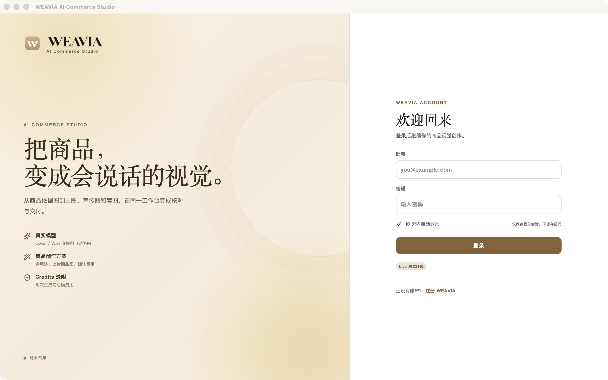

# WEAVIA 竞品对标、UI/UX 差异与补齐方案

日期：2026-10-29。范围：当前 `/Users/jiangliu/Documents/weavia` 源码、当次桌面登录页、竞品官方公开材料。本文是对标研究和改造规格建议，不代表已经实现，也不是竞品付费产品完整实测。

## 1. 结论与定位

建议主线：围绕商品完成视觉内容生产、修改、核对和交付。当前最明显的差距在于任务组织与结果控制：代码能提交模型任务，但用户还需跨页面找结果、修改、核对和下载，缺少按商品组织的完整交付计划。

现有优势基础：商品依据图、已核实事实、禁止声明、模型路由、任务与 Credits、素材和版本。应把这些基础转化为用户可感知的商品准确性、修改效率和交付可靠性。上述优势是可发展的方向，尚无数据证明领先竞品。

建议首轮目标：一个明确品类、一个主要电商渠道、一件商品的一套可采用素材。三图套装可以作为验证范围候选，不是未经确认的新增范围承诺。

## 2. 证据层级与限制

1. 当前源码用于判断 WEAVIA 功能结构、数据和调用逻辑。
2. 当次原生截图只覆盖登录页，未输入账号、未付费调用，登录后页面没有本轮截图验证。
3. 运行的 `.app` 文案与目录内 `AuthShell.tsx` 不一致：包显示“商品创作方案/服务可用”，源码仍是“Skill 与 AI 应用/服务已连接”。包对应源码提交未核实，不把两者合并为同一版本结论。
4. 竞品能力来自本次官方网页/帮助文档，实际质量、付费限制、错误恢复和内页 UI 未作同条件验证。
5. 极光商品套图网址本次 Web 读取失败、浏览器导航超时；PicCopilot 官网本次读取超时。它们保留为后续对标对象，本报告不以旧截图或历史记录证明其当前功能。
6. UI 建议是基于当前代码结构和可见登录页的设计推导，不宣称完成所有页面的视觉审核或无障碍合规检查。

## 3. 对标对象：每家取一个核心能力

| 对标对象 | 本次公开材料可确认内容 | 借鉴点 | 本次未验证 |
| --- | --- | --- | --- |
| Photoroom | 批量上传、统一编辑设置、批量导出；强调目录风格一致 | 从一批商品到一批交付物的工作流 | 实际模型效果、登录后每一步、宣称增长数据 |
| Flair | 拖放画布、场景道具、可复用模板、产品与人物修改工具入口 | 可视化控制构图，围绕选中对象进行修改 | 内页细节、编辑准确性、真实协作行为 |
| Canva 可画 | 品牌工具箱包含 Logo、颜色、字体；编辑器内可调用 | 品牌规则跨作品复用、图文排版资产化 | AI 生成一致性和具体账号权益 |
| 极光/PicCopilot | 本次未完成当前页面访问核验 | 后续重点看电商任务覆盖、套图和专用表单 | 当前功能、效果、价格均不在本次结论内 |

来源：

- [Photoroom Batch](https://www.photoroom.com/batch)
- [Flair 官方产品页](https://flair.ai/)
- [Canva 可画品牌工具箱](https://www.canva.cn/help/brand-kit-cn/)

## 4. UI/UX 与功能逻辑差异矩阵

| ID | 维度 | WEAVIA 当前代码结构 | 对标目标/借鉴依据 | 要补的 UI | 要补的功能逻辑 |
| --- | --- | --- | --- | --- | --- |
| G01 | 开始任务 | 多入口：创作框、Skill、应用、工具 | 场景和模板帮助用户先确定产物；参考 Flair 模板 | 按主图/场景/宣传/套图选择；显示示例和预计输出 | sceneId 对应实际输入约束、能力、输出计划，不只是提示词 |
| G02 | 首次输入 | 渠道/市场/语言/商品/人群和模型参数并列 | 减少首次决策负担，属于本报告 UX 建议 | 默认推荐、必需项先填，高级设置折叠 | 能力驱动字段、草稿保留、模板切换不丢输入 |
| G03 | 参考素材 | 附件列表+单一商品依据图 | Flair 以产品和场景元素组织内容 | 素材用途标记：商品原图、风格、版式、背景 | reference role、原图保护策略、上传归属/格式校验 |
| G04 | 模型选择 | 用户直接选模型与多个参数 | 业务操作优先，模型为高级控制 | “快速/精细/适合文字”等可解释预设，仍能展开型号 | 预设必须映射真实可用模型，不虚构效果或无限承诺 |
| G05 | 生成前预览 | 无用途明确的套图计划 | 批量生产需明确目标；参考 Photoroom 批量 | 用途、规格、文字、张数卡片，可编辑 | OutputPlan、每输出独立任务、版本化规格 |
| G06 | 结果工作区 | /create 单任务展示，编辑/作品需跳转 | 围绕选中产物继续处理；参考 Flair 可视化工具 | 中央结果、侧边修改、底部版本/输出带 | 选中 outputId、parentVersionId、编辑任务继承上下文 |
| G07 | 修改控制 | 本地亮度等；AI 改图入口；提示词保存复用旧图 | Flair 画布和修改工具体现可控创作 | 保护商品、改背景、改构图、局部涂抹、前后对比 | 真实 image edit/mask、不可变原图、新资产版本 |
| G08 | 文案与品牌 | 禁止声明+品牌素材分类，缺品牌规则模型 | Canva 品牌工具箱 | Brand selector、Logo、色板、字体、文字编辑 | BrandKit、排版规格、可编辑文本、字体资源与导出合成 |
| G09 | 批量 | 最多 4 张同意图输出，非批次 SKU | Photoroom 统一设置后批处理与导出 | SKU 表格、映射预览、批次进度、失败筛选 | Batch、Item、并发/预算、幂等、只重试失败项 |
| G10 | 核对/版本 | Work 级审核，历史版本共享状态 | 本报告交付治理建议；未声称竞品都做到 | 每版核对清单、备注、修改标记 | 审核绑定 asset/version、人/时间、修改后重审 |
| G11 | 导出 | 单文件下载 | Photoroom 明确完整批次导出 | 交付抽屉：渠道规格、格式、命名、多选/ZIP | ExportJob、渲染/打包、命名规则、manifest、失败恢复 |
| G12 | 状态与费用 | 前端估算、固定百分比、重试丢部分上下文 | 本报告可靠性要求；不以竞品营销推断实现 | 阶段状态、逐项费用、恢复/重做动作区分 | quote 参数快照、持久幂等键、按输出恢复和结算 |
| G13 | 视频 | 分镜拼成单个文生视频提示词 | 商品视频须保留输入与结果可追溯，属于建议 | 分镜/片段/成片三类状态；镜头列表 | 图生视频能力、逐镜头任务、客户端合成与恢复 |
| G14 | 数据复用 | 商品、作品/审核在本机；任务服务端 | 本报告跨设备/团队交付建议 | 本地/同步/失败标志、项目和品牌归属 | 身份映射、单一权威、同步冲突/删除规则 |

## 5. 建议的信息架构

```text
创作：业务场景、上传、最近项目
商品：商品/SKU/依据图/事实/关联成果
品牌与素材：Brand Kit、素材、模板资源
作品与交付：按商品/项目/批次查看、审核、打包
任务：跨项目队列、失败、结果恢复
高级工具：DAG、模型高级参数、Skill 作者工具
账户：余额/流水、会员订单、安全、存储、诊断
```

Skill/AI 应用/Agent 可以保留底层概念，面向商家统一呈现为“创作方案/模板”。DAG 属于高级编排，不要求普通运营先理解节点。

## 6. 页面级补齐规格

### P01 创作首页

- 首屏：明确“为哪件商品制作什么”，提供上传区和 3–4 个首批可用场景；真实示例展示输入和交付物。
- 开始后：展示已选商品/素材摘要；渠道预设自动带入尺寸/语言建议，但可改。
- 模型/负向词/种子/参考强度放高级面板；费用和生成按钮始终容易找到。
- 无可用模型、素材上传中、报价失效、余额不足分别给明确状态和下一步。

### P02 商品创作工作区

- 建议结构：左侧商品/依据图和本次简报，中央结果画布或网格，右侧选中结果的操作，底部输出与版本。
- 同屏支持选图、继续修改、核对、下载；不要求用户到任务中心等待结果。
- 尺寸为规格建议：桌面 1440px 可采用约 240px/自适应/300px 三栏；窄窗口收起侧面板，不强行挤三栏。需后续原型验证，未指定像素稿。
- URL 可定位具体项目/输出/版本，刷新和回退不丢上下文。

### P03 输出计划/套图

- 生成前逐卡说明：主图/场景/卖点、规格、输入、文案、费用；支持调整顺序与要求。
- 结果逐卡保存，单张失败不清空整组，修改只重做该项。
- 一件商品不同用途输出使用一致的事实、品牌和商品原图约束；不能只把 count 由 4 改为 7。

### P04 图片修改

- 保留原图；将“保存说明”与“AI 修改”分开命名。
- 整图、背景、局部等操作只在模型实际支持时开放；局部编辑需要 mask 真实输入。
- 文案尽可能用可编辑文字层叠加，画面生成与排版导出分开；这需要新增合成逻辑，不只是输入框。
- 原图/新图对比，保存父版本、修改目标和新任务；新版本重新待核对。

### P05 作品与交付

- 商品/项目/批次视图；可按待核对/通过/需修改筛选。
- 可见规格、用途、版本与是否已导出；多选后出现批量操作条。
- 导出抽屉可选图片格式、尺寸、文件名规则、套图顺序；ZIP 含文件与清单。
- 允许明确提示后下载未核对结果，是否强制审核由产品策略决定；不把“人工通过”误称平台合规认证。

### P06 品牌与素材

- 品牌包含 Logo/安全区、色彩、字体、语气、禁用内容、模板；素材有明确引用角色。
- 品牌规则需要落实到提示词/排版/导出，并用样本验证；保存色板本身不保证 AI 图片一致。
- 素材不足时就在当前流程补充，避免跳回商品页造成草稿丢失。

### P07 任务与异常

- 显示校验、排队、生成、下载保存、完成等真实阶段；没有依据时不显示具体百分比。
- 提供“查询原任务”“重新下载缺失结果”“重新生成”不同动作，并说明费用。
- 响应丢失先查询；用户真正重新生成才新建幂等键。错误信息附可复制任务 ID。

### P08 账户与后台

- 前台补流水、套餐/订单、安全入口；后台能读写不等于客户能自助完成。
- 后台增加场景版本、支持的模型/素材角色、输出计划、试运行样本和发布门禁。
- 任务支持按用户/项目/批次定位、结果可读性、账本和路由关联；收费异常依权威账本处理。

## 7. 前后端共同需要的数据结构

以下为建议结构，应复用现有 conversation/任务/商品/资产，确认设计后再实现，不能平行新增第二套同义对象。

| 对象 | 最小关键字段 | 目的 |
| --- | --- | --- |
| 创作项目/会话 | id、user/workspace、product、brand、scene、brief、status | 让任务围绕一个交付目标聚合 |
| 输出计划项 | id、purpose、spec、copy、referenceRoles、order、quote | 区分主图/场景/卖点而非同意图多张 |
| 模型任务 | taskId、planItemId、inputSnapshot、idempotencyKey、quoteId | 每输出执行与费用追溯 |
| 资产版本 | versionId、assetId、parentVersionId、taskId、editIntent | 真实修改、重启后版本关系 |
| 核对记录 | versionId、status、actor、time、checks、note | 版本级核对，不继承旧图通过状态 |
| 导出记录 | exportId、versionIds、preset、fileNames、status、manifest | 成套交付可恢复与重现 |
| 客户端检查点 | runId、nodeId、submittedTaskId、state、nextNodes | 保持客户端 DAG 架构并支持恢复 |

## 8. 建议开发顺序和验收门槛

| 顺序 | 工作包 | 对应功能编号 | 验收门槛 |
| --- | --- | --- | --- |
| R0 | 固定评审版本 | C12、B07 | app、前端、API、Worker 的版本可追溯；目录与截图一致 |
| R1 | 可信付费与恢复 | C01/C04、A07、B03/B05 | 正式报价覆盖开放参数；无模型不能提交；未知结果不重复付费；断网重启能找回 |
| R2 | 核心图片工作区 | C03/C04/C07 | 同一商品内看到所有输出、选图修改、真实新资产、逐版核对与下载 |
| R3 | 最小成套交付 | F01/F11、B06 | 不同用途输出计划、独立任务、部分失败重做、整套 ZIP |
| R4 | 品牌与文案控制 | F05、C07 | 品牌设置可复用、文字可改、商品信息不被静默覆盖 |
| R5 | 批量与团队 | F04/F10、B02/B06 | 多 SKU 映射、批次预算、跨账号/设备归属、完整失败恢复 |
| R6 | 视频及高级 DAG | C08/C10、B04 | 商品输入真正进入视频；逐镜头与成片分开验收；本地检查点续跑 |

R0–R2 完成后先评估真实图片试用；不要为了对标全功能而将所有阶段同时上线。未开发功能从导航隐藏或说明未开放，不做假成功。

## 9. 如何证明达到对标标准

建议组织 20 个获得授权的真实 SKU，同样输入/用途/尺寸，对照现有工作方式、WEAVIA 和 1–2 个竞品。分开记录机器生成耗时、用户操作耗时、人工修正与最终交付；至少包含透明/反光、包装文字、简单主体等样本。此数量仅是试验建议，不具统计充分性。

指标：首次可采用结果时间、完成一套交付时间、商品外观/文字错误率、修改次数、每套采用成本、部分失败恢复、重复扣费事件、重复使用率。竞品未实际测试的字段留“未知”，不编造分数；不使用厂商增长百分比作为 WEAVIA 的收益预测。

对标通过应意味着：同一件商品、同一任务、同一预算口径下可完成交付，并清楚说明弱项。模仿颜色和页面卡片数量不构成达标。

## 10. 当次视觉记录

步骤 1：绑定当前项目路径对应 `.app`，看到登录页；视觉品牌统一、主操作明确。步骤 2：观察到服务状态从检测中变为可用，但未验证检测覆盖范围。步骤 3：未输入凭据，登录后工作流未进入，无法给出逐页视觉通过结论。



可见问题：左侧装饰区域占比大，可换成真实商品输入/输出案例；没有忘记密码入口；重要辅助文案与主标题差距较大，需验证小字可读性、焦点、缩放与对比度。商品套图宣传是否兑现需按对应版本验收。颜色/字体与登录结构可以保留；内部工作区仍需独立验证。

相关功能底稿：[功能总览](../function-inventory/00-overview-and-decisions.md)。本次只生成评估与规格建议，没有改业务代码或生成视觉稿。
