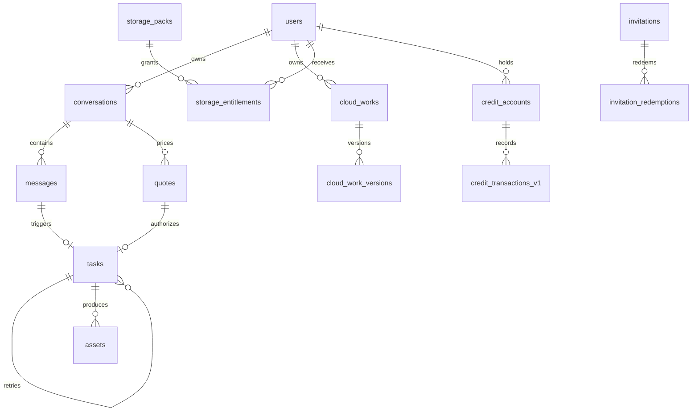

# WEAVIA V1 ERD 与数据模型

## 1. 边界

| 层 | 事实源 | 存什么 |
| --- | --- | --- |
| 服务端 PostgreSQL | 会话、消息、报价、任务、积分、邀请、云存元数据 | 文本、参数、状态、对象 key；不存作品文件 |
| 客户端 SQLite | 作品、版本、本地素材、会话缓存 | 本地文件路径、缩略图、业务元数据 |
| 阿里云 OSS | 云存副本 | 作品文件；私有 Bucket，预签名访问 |

原则：

- 本地作品是事实源；云端是副本，不反向覆盖本地。
- 参考图/mask 为调用供应商临时上传，任务结束 24h 清理，不进作品库。
- 服务端生成结果保留 7 天供下载，过期删除；客户端应立即落到本地。

## 2. 服务端 ERD



## 3. 表说明

### conversations

| 字段 | 类型 | 说明 |
| --- | --- | --- |
| id | uuid PK | 会话 ID |
| user_id | uuid FK users | 所有者 |
| workspace_id | uuid FK workspaces | 可空 |
| project_id | uuid FK projects | 可空 |
| title | text | 默认“新会话” |
| mode | text | image / video（V1 只 image） |
| status | text | active / archived |
| last_message_at | timestamptz | 列表排序 |
| created_at / updated_at | timestamptz | |

索引：`(user_id, updated_at desc)`。

### messages

| 字段 | 类型 | 说明 |
| --- | --- | --- |
| id | uuid PK | |
| conversation_id | uuid FK | 级联删除 |
| user_id | uuid FK | |
| role | text | user / assistant / system |
| content | text | 文本 |
| params | jsonb | 模型、参数、场景快照 |
| attachments | jsonb | 素材元数据：clientAssetId/uploadedAssetId/role/mime/size/sha256 |
| client_message_id | text | 客户端幂等 ID，可空 |
| task_id | uuid FK tasks | 可空 |
| created_at | timestamptz | |

唯一：`(conversation_id, client_message_id) where client_message_id is not null`。

### quotes

| 字段 | 类型 | 说明 |
| --- | --- | --- |
| id | uuid PK | |
| user_id / workspace_id | uuid | |
| conversation_id | uuid | 可空 |
| currency | text | credits |
| total_credits | bigint | >0 |
| line_items | jsonb | model/count/unit/total |
| request | jsonb | 报价参数快照，用于提交时复核 |
| status | text | active / consumed / expired / cancelled |
| expires_at | timestamptz | 建议 5 分钟 |
| idempotency_key | text unique | |
| created_at / consumed_at | timestamptz | |

规则：一个 quote 只能被一个 task 消费；参数变化必须重新报价。

### tasks（扩展）

新增：`conversation_id`、`message_id`、`quote_id`、`parent_task_id`、`mode`、`edit_mode`、`mask_asset_id`、`output_plan`、`provider_endpoint`、`provider_task_id`、`cancel_requested_at`、`output_expires_at`。

状态：

```text
reserved → queued → running → reconciling → success
                                  ↘ failed
             ↘ cancelled（仅上游支持时）
```

### invitations

`code` 唯一，`max_uses`、`used_count`、`expires_at`、`created_by`；`invitation_redemptions` 唯一 `(invitation_id, user_id)`，防同一账号重复兑换。

### 云存

- `cloud_works`：`local_work_id` + `user_id` 唯一；`status=active/deleted`。
- `cloud_work_versions`：`(cloud_work_id, version_no)` 唯一；`asset_key` 为 OSS key。
- `cloud_storage_usage`：按用户累计 bytes，上传前校验配额。
- `storage_packs` / `storage_entitlements`：10GB/30 天等 SKU；到期只读 30 天，再删除。

### 积分

- 免费额度：`credit_transactions_v1` 写一条 `grant`，`reference_type='free_plan'`，部分唯一索引保证每账号一次。
- 任务：`reserve → confirm/release`；失败释放；套餐购买不退款，任务失败退 Credits。

## 4. 本地 SQLite

见 `ddl/local_sqlite_v1.sql`。核心：

- `works` / `work_versions`：本地作品与版本，`server_work_id` 可空。
- `conversations_local` / `messages_local`：服务端会话/消息缓存，`server_id` 可空。
- `assets_local`：本地素材；`local_path` 不存 base64。
- `outbox`：离线待同步操作，重启后重试。

文件布局：

```text
AppLocalData/works/{workId}/{versionId}.png
AppLocalData/works/{workId}/thumb.jpg
AppLocalData/assets/{assetId}.{ext}
```

## 5. 状态机

### Quote

```text
active → consumed
       → expired
       → cancelled
```

### Cloud version

```text
local → uploading → uploaded
                 ↘ failed → retry
```

### 删除

- 删本地作品：提示“云端仍有副本”，不自动删云。
- 删云存：软删 `deleted_at`，OSS 生命周期 30 天后清理；不删本地。
- 过期存储包：只读 30 天 → 删除云副本；本地不受影响。
